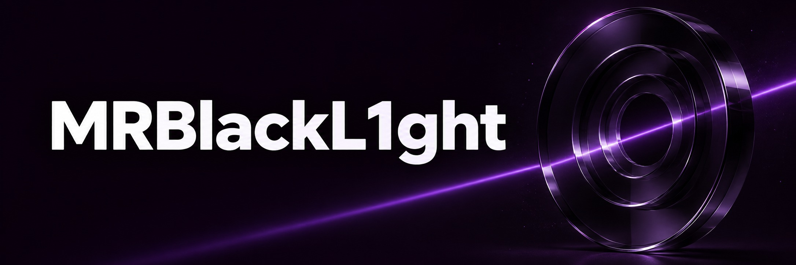

<h1 align="center">Python и веб-разработка</h1>

  Привет! Я делаю Discord-ботов, сайты и серверную часть для них.
  Мне нравится собирать проект целиком — от первых моделей данных до интерфейса, которым удобно пользоваться.

  <code>Python</code> · <code>discord.py</code> · <code>SQLite</code> ·
  <code>HTML</code> · <code>CSS</code> · <code>JavaScript</code>

  <a href="https://github.com/MRBlackL1ght/portfolio"><strong>Портфолио</strong></a>
  &nbsp;·&nbsp;
  <a href="https://t.me/mrblacklight"><strong>Связаться в Telegram</strong></a>

## Избранные проекты

### Мир Авернус

Текстовая ролевая игра прямо в Discord. Игроки проходят сюжетные главы, вступают в гильдии, осваивают ремесло и сражаются на рейтинговой арене. Игровая логика работает на Python, а прогресс хранится в SQLite.

[Документы проекта](https://github.com/MRBlackL1ght/avernus-legal)

### Wexel

Три бота для одного Discord-сообщества. **Main** помогает управлять сервером, **Fun** добавляет развлечения, а **Moderation** отвечает за модерацию и журнал событий.

### Оно тебе надо

Лендинг вымышленного аукциона на HTML и CSS. Крупная типографика на обложке и карточки с историями лотов задают странице вид аукционного каталога.

[Исходный код](https://github.com/MRBlackL1ght/ono-tebe-nado)
